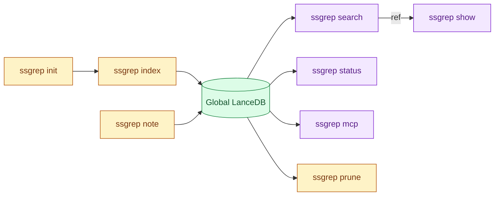
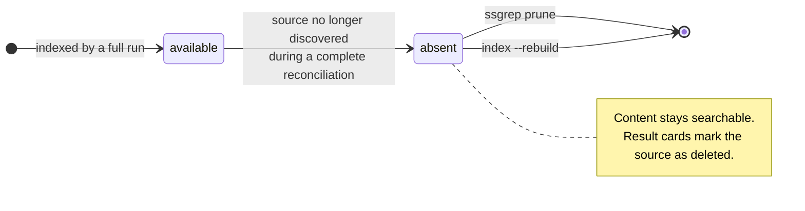

# Command Reference

Run `ssgrep --help` or `ssgrep <command> --help` for the installed CLI's authoritative option list.

## Command Lifecycle



*Legend: amber = commands that write to the index, green = the database, purple = read-only commands.*

| Command | Purpose |
|---|---|
| [`init`](#init--one-time-setup) | One-time setup: skills, MCP registration, first index |
| [`index`](#index--build-or-update-the-global-index) | Build or update the global index |
| [`search`](#search--find-relevant-episodes) | Find relevant episodes |
| [`show`](#show--inspect-one-episode) | Inspect one episode |
| [`status`](#status--inspect-the-global-database) | Inspect the global database |
| [`note`](#note--add-a-durable-searchable-note) | Add a durable searchable note |
| [`prune`](#prune--permanently-delete-archived-content) | Permanently delete archived content |
| [`mcp`](#mcp--start-the-mcp-stdio-server) | Start the MCP stdio server |
| [`rules`](#rules--print-the-operating-rules) | Print the operating rules |
| [`version`](#version) | Print the version |

## `index` — Build or update the global index

```bash
ssgrep index [--rebuild] [--no-subagents] [--quiet] [--allow-shrink] [--scope PATH] [--live] [--full-reprocess]
```

With no options, this reconciles the complete discovered corpus. Files whose size, modification time, and first-line hash have not changed are skipped; changed files are parsed again.

| Option | Effect |
|---|---|
| `--allow-shrink` | Confirms a rebuild when discovery would reduce a populated database to less than half its existing session count. |
| `--no-subagents` | Excludes subagent transcripts for this run. |
| `--quiet` | Suppresses the human progress line. |
| `--rebuild` | Recreates the Lance tables and embeddings. |
| `--scope PATH` | Ingests only sessions with a recorded `cwd` equal to or beneath the absolute `PATH` for this run (applied across every runtime that records a working directory). It does not create a separate database. Authored notes and explicitly configured external roots remain included. |
| `--live` | Keeps polling for changes in the foreground until interrupted, instead of exiting after one reconciliation pass. No daemon is installed; the process must stay running. |
| `--full-reprocess` | Re-runs every discovered source, ignoring the cursor checkpoints that normally skip unchanged files. |

A normal full run marks indexed sources that are no longer discovered as absent but retains their searchable content. See [Archive Semantics](#archive-semantics).

A build that was interrupted or failed before it finished (including an interrupted `--rebuild`, or an empty `lancedb/` directory) is resumed by running plain `ssgrep index` again; `--rebuild` is needed only when the schema or embedding model changed or the index files are damaged (`status` and `index` then exit `4`). Interrupting a one-shot run exits `130` and leaves the index resumable. With `--live`, `--rebuild` and `--full-reprocess` apply to the first poll cycle only, and an interrupt lets the running cycle finish before one final catch-up (a second interrupt stops immediately with exit `130`).

## `init` — One-time setup

```bash
ssgrep init
```

`init` does three things in order:

1. Discovers every supported runtime and installs an idempotent `ssgrep` skill into each agent harness's own global skill directory.
2. Registers the `ssgrep mcp` stdio server with every supported MCP client (the same registration `ssgrep mcp install` performs).
3. Runs one normal index.

| Runtime | Skill directory | Honors override |
|---|---|---|
| `claude` | `$CLAUDE_CONFIG_DIR/skills/ssgrep` | `CLAUDE_CONFIG_DIR` |
| `opencode` | `~/.config/opencode/skills/ssgrep` | `XDG_CONFIG_HOME` / `OPENCODE_CONFIG_DIR` |
| `codex` | `~/.codex/skills/ssgrep` | `CODEX_HOME` |
| `pi` | `~/.pi/agent/skills/ssgrep` | `PI_CODING_AGENT_DIR` |
| `prime-agent` | `~/.prime/agent/skills/ssgrep` | `PRIME_AGENT_CODING_AGENT_DIR` |

> [!TIP]
> Safe to re-run: an exact re-run leaves files untouched, upgrades re-render managed skill files, and user edits are never overwritten.

`--json` returns `{ok, skills, mcp, sources, index}`, where `mcp` maps each client name to `{status, config}`.

## `search` — Find relevant episodes

```bash
ssgrep search <QUERY> [--limit N] [--token-budget T] [--where PREDICATE]
```

Search is global by default. LanceDB embeds the query into a token matrix and scores every chunk with native MaxSim, then ssgrep keeps the best-ranked chunk for each episode.

| Option | Effect |
|---|---|
| `--limit` | Defaults to 10, must be at least 1, and is capped at 50. |
| `--token-budget` | Defaults to 1500 and bounds the approximate size of returned cards. |
| `--where` | Supplies a raw SQL predicate applied before ranking. |

### Predicate fields

Useful predicate fields include:

| Group | Fields |
|---|---|
| identity and location | `project`, `source_path`, `source_project`, `source_status`, `session_id`, `episode_id`, `runtime` |
| episode metadata | `content_type`, `title`, `timestamp`, `git_branch`, `cwd`, `files_touched`, `tool_names` |
| agent metadata | `is_subagent`, `parent_session_id`, `agent_type`, `agent_name`, `agent_description`, `agent_model` |
| Claude metadata | `claude_version`, `entrypoint`, `permission_mode`, `user_type` |

Examples:

```bash
ssgrep search "database retry" --where "project = '/Users/me/code/app'"
ssgrep search "permission issue" --where "is_subagent = true AND content_type = 'response'"
ssgrep search "old workaround" --where "source_status = 'absent'"
```

### Result cards

Human-readable cards contain the episode title, a relevance score, project/source metadata when available, files, agent attribution for subagents, and a bounded excerpt. Scores are ranking values, not normalized probabilities. Use the returned ref with `show`.

### Exit codes

| Code | Meaning |
|---|---|
| `0` | results found |
| `1` | unexpected failure |
| `2` | usage error |
| `3` | no matching data, an empty index, or an unknown `show` ref |
| `4` | missing or unusable index |

## `show` — Inspect one episode

```bash
ssgrep show <REF>
```

Returns the prompt and response stored for an episode. The ref format is `<session-id>:ep:<episode-number>`. With no usable index it exits `4` like `search`, whatever the ref; an unknown or malformed ref against a ready index exits `3`.

The CLI detail layer bounds prompts at 50,000 characters and responses at 150,000 characters and reports truncation in JSON.

## `status` — Inspect the global database

```bash
ssgrep status
ssgrep status --json
```

Text output reports:

- session, episode, and chunk counts
- database size in bytes and MiB
- the time of the most recent index run
- the embedding model and vector dimension
- skipped and malformed record counts from the most recent run
- tombstoned source/chunk counts when archived content exists
- the archived-source count when sources were served from their indexed snapshot this run (transcript file missing from disk)

JSON additionally exposes the complete `IndexStats` contract. The total counts include archived rows; the tombstone fields identify the archived subset.

## `note` — Add a durable searchable note

```bash
ssgrep note --title "how do we handle retry backoff" --body "Use bounded exponential backoff."
printf '%s\n' "Longer answer" | ssgrep note --title "what is our retry policy" --body -
ssgrep note --title "project-specific convention" --body "..." --project-dir /path/to/project
```

The title becomes the prompt and the body becomes the response in a native transcript record pair.

> [!TIP]
> Phrase the title like a query you expect to search for later.

- `--project-dir` records the note's `cwd` metadata; it does not select another database.
- Notes are written only beneath the global ssgrep application-data directory.
- The command then runs reconciliation so the note is normally searchable immediately; if reconciliation fails, the saved note is picked up by a later successful `ssgrep index`.
- MCP clients can use `save_note`; older servers can keep using the CLI.

### Original investigation metadata

Metadata records what producing the knowledge cost, not how long the note write took:

```bash
ssgrep note --title "booking join fix" --body "Join on both keys." --work work.json
ssgrep show NOTES_REF --json
ssgrep note --ref EXISTING_REF --work corrected-work.json
ssgrep note --ref EXISTING_REF --infer-work
```

`--work` reads one regular JSON file, at most 64 KiB. `--ref` enriches existing
indexed knowledge without duplicating text. `--infer-work` explicitly recovers
available historical evidence; it never scans or rewrites all old transcripts.

| Field | Meaning |
|---|---|
| `work_id` | Required, stable investigation ID; use the same ID for notes from the same investigation. |
| `provider`, `model` | Optional explicit provider and exact model ID; neither is guessed from the runtime. |
| `elapsed_seconds` | Optional nonnegative whole seconds for the investigation, not active work or time saved. |
| `usage` | Optional nonnegative integer `input_tokens`, `output_tokens`, `cache_read_tokens`, `cache_write_tokens`, `reasoning_tokens`. Preserve the source provider's meanings; overlapping categories must not be summed as independent costs. |
| `basis` | `agent_estimated` (default), `runtime_reported`, or `transcript_inferred`. Supplied provenance is not provider attestation. |
| `contributions` | Optional list of provider/model/usage/basis objects for mixed-model work; replaces top-level provider/model/usage. |
| `source_ref` | Provenance link; required for `transcript_inferred` metadata. |

Missing fields remain unknown, not zero. Multiple notes share one work ID and its
current revision; never sum that investment once per note, across different model
token units, or across revisions. Corrections retain immutable previous revisions.
Metadata binds to the indexed episode's content; changed text cannot inherit stale
investment silently. `show` displays it as **original investigation**, not savings.

Historical recovery supports Claude, Codex, Pi and OMP JSONL sources up to 8 MiB.
It verifies the selected episode against the indexed content. Explicit model and
provider fields are retained where available; missing provider stays unknown.
Elapsed time requires ordered timestamps from the task prompt to an explicit final
assistant completion and is marked inferred, rounded down to whole seconds. It is
not the duration of an entire resumed session. Incomplete or conflicting usage is
omitted; Codex session-wide
token counters are not attributed to one task. Unsupported, missing, oversized or
changed sources return `work_evidence_unavailable`; explicit enrichment remains
available.

Companion records live in `work-metadata/` under the application-data root with
owner-only permissions. Native note JSONL and the search-index schema are unchanged.
Old notes need no migration; old ssgrep versions ignore the companions and can still
index/read new notes. Read paths never create metadata or infer missing values.
Work metadata belongs to saved knowledge, not the optional accounting profile:
`savings purge` does not erase it. Back up the notes and companion directory together.

These records do **not** change existing savings calculations, pricing, previously
exported totals, or export permissions. They supply original-investment evidence
for inspection; causal savings and cross-provider money conversions remain separate.

## `prune` — Permanently delete archived content

```bash
ssgrep prune [--older-than DAYS] [--dry-run] [--yes]
```

`prune` operates only on sessions whose `source_status` is `absent`.

| Option | Effect |
|---|---|
| `--dry-run` | Previews the matching session, episode, and chunk counts. |
| `--older-than DAYS` | Selects sessions that have been absent for at least that many days; the default `0` selects every tombstoned session. |
| `--yes` | Skips confirmation and is required for non-interactive deletion. |

> [!CAUTION]
> Pruning cannot be undone. Back up the application-data root first if it may hold the only remaining copy.

## `mcp` — Start the MCP stdio server

```bash
ssgrep mcp
```

Starts the MCP server with read tools (`search_sessions`, `show_session`, `index_status`) and the explicit local write tool `save_note`. Server construction reconciles every discovered runtime in a background thread, so a fresh installation builds its index without a separate `ssgrep index` run. While that reconcile runs, search, detail and save calls report that an update is in progress and ask the caller to retry.

The server stops when stdin closes or on SIGINT/SIGTERM. A signal gives an in-flight reconcile a short grace period and then ends the process by that signal (shell status 130 for SIGINT, 143 for SIGTERM) without a traceback.

See [mcp-setup.md](mcp-setup.md) for client configuration and tool details.

### `mcp install` — Register ssgrep with MCP clients

```bash
ssgrep mcp install            # every supported client
ssgrep mcp install cursor zed # a subset: claude, cursor, zed, codex, opencode
```

Writes the `ssgrep mcp` stdio registration into each client's own configuration (Claude Code is registered through its `claude mcp add` CLI).

Idempotent: an exact existing entry is untouched, a stale ssgrep-owned entry is replaced, and unrelated settings are preserved.

Each client reports one of these statuses:

- `installed`
- `updated`
- `already_installed`
- `skipped: ...`
- `error: ...`

With `--json`, the `data` object is `{clients: {<name>: {status, config}}}`. Every client is always attempted and reported. Exit codes: `0` when no client ended in `error: ...` (a `skipped: ...` client is not installed and does not count), `1` when at least one did, and `2` for an unknown client name. When a client fails, `--json` writes `{"ok": false, "condition": "client_registration_failed", "message": ..., "command": null, "clients": {...}}` instead of the usual envelope. `ssgrep init` follows the same rule for its skill and MCP steps and, on failure, adds its `skills`, `mcp`, `sources` and `index` fields to that document.

## `rules` — Print the operating rules

```bash
ssgrep rules
ssgrep rules --short
ssgrep rules --json
```

Prints the same guidance body that `init` installs as a skill (see [agent-guidance.md](agent-guidance.md)).

| Form | Output |
|---|---|
| `ssgrep rules` | the full guidance body |
| `--short` | only the numbered non-negotiables, sized to paste into a project's `AGENTS.md` or `CLAUDE.md` |
| `--json` | `{ok, data: {version, executable, short, full}}` |

Output is raw markdown by design — it is meant to be pasted and read by agents — and the command reads no index, loads no model, and creates no files, so it works on a fresh install and inside CI.

## `version`

```bash
ssgrep version
ssgrep --version
```

`help` and `about` are also available from the CLI framework.

## JSON Output

Data-oriented commands accept the global `--json` option. Successful output uses a single envelope:

```json
{"ok": true, "data": {"...": "command result"}}
```

A known data-layer failure (missing index, empty query, unknown ref, and similar) fails with a JSON document carrying a machine-readable condition and the suggested recovery command when one is safe:

```json
{
  "ok": false,
  "condition": "missing_index",
  "message": "No global index found. Run `ssgrep index` first.",
  "command": "ssgrep index"
}
```

A plain usage error (unknown flag, unknown `mcp install` client name, and similar) instead surfaces the CLI framework's generic envelope, `{"ok": false, "error": {"type": "Exit", "message": "...", "code": N}}`.

> [!IMPORTANT]
> Either way, the process exit code (see [Exit codes](#exit-codes)) is the reliable signal to script against.

## Archive Semantics

ssgrep stores chunk and episode text rather than offsets into mutable source files. During a complete reconciliation, a transcript that is no longer discovered is marked `source_status = 'absent'`; its content remains searchable and result cards are marked as source-deleted.



To restrict results to files still present:

```bash
ssgrep search "query" --where "source_status = 'available'"
```

To inspect and remove archived data:

```bash
ssgrep status
ssgrep prune --dry-run
ssgrep prune --yes
ssgrep prune --older-than 30 --yes
```

`prune` is the command dedicated to deleting selected tombstoned rows.

> [!WARNING]
> A full `index --rebuild` instead reconstructs every table from current discovery and therefore does not preserve undiscovered archived rows.
